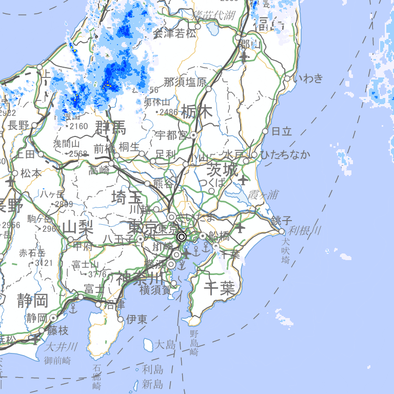
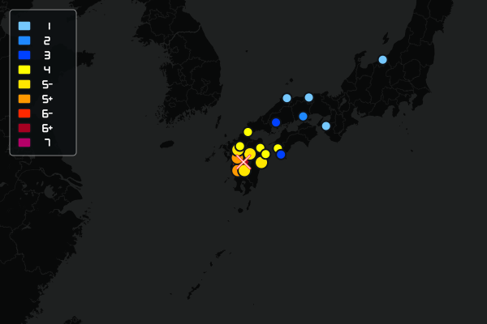
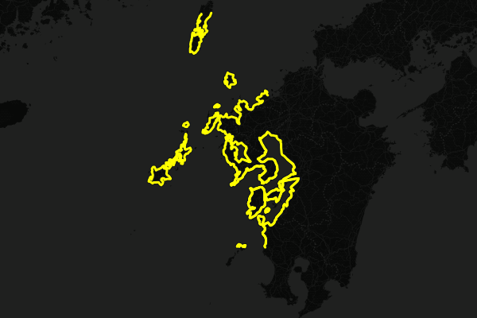

# Shindo Discord Bot

**地震・津波の速報から、地域の気象警報と雨雲まで。Discordで確認できる防災・天気Botです。**

気象庁・P2P地震情報をもとに、指定チャンネルへ地震・津波や市区町村別の気象警報を通知します。地域を選んで雨雲レーダーを表示したり、今後3時間の降水予報を通知したりできます。

[画像で見る](#demo) · [最初の設定](#quickstart) · [コマンド一覧](#commands) · [Railwayで動かす](#railway) · [開発・検証](#development)

| できること | 内容 |
| --- | --- |
| 過去の地震を調べる | 2015年1月10日以降の詳細な震度情報を、発生日・観測地域／震源・震度範囲で検索 |
| 地震・津波を知らせる | 緊急地震速報、地震情報、津波情報。地震は最低震度を指定可能 |
| 地域の警報を知らせる | 大雨・土砂災害・高潮・暴風などの警報、河川氾濫情報。注意報も選択可能 |
| 雨雲を画像で見る | 気象庁の雨雲画像と地理院地図を合成。動画・凡例へのリンク付き |
| 雨の予報を知らせる | 今後3時間の時間別降水予報を、指定した降水量で通知 |
| Discordだけで設定する | 地域の候補選択、通知先の指定、設定確認、地域ごとの通知停止 |

<a id="demo"></a>

## 画像で見る

以下は**Botの出力画像・既存サンプル**です。Discordアプリのスクリーンショットではありません。保存済みの画像であり、現在の地震・津波・雨雲の状況を示すものではありません。

### 雨雲レーダー

`/weather radar` で市区町村を選ぶと、周辺の雨雲画像を表示します。白丸は地域の中央付近です。Discord上では、メッセージのタイトルから気象庁の動画・凡例を開けます。

<p align="center">
  
</p>

*2026年9月22日の公開API接続検証で、実際のBotの画像生成処理から保存した画像です。雨雲：気象庁／背景：地理院タイル。*

### 地震・津波マップ

<table>
  <tr>
    <th>震度分布のサンプル</th>
    <th>津波注意報のサンプル</th>
  </tr>
  <tr>
    <td></td>
    <td></td>
  </tr>
  <tr>
    <td>観測点を震度別の色で表示します。</td>
    <td>対象の沿岸を線で強調します。</td>
  </tr>
</table>

既存の `sample-output/` に保存されていたサンプルです。現在の通知内容・配信状態を表すものではありません。画像の元ファイルと更新方法は [画像について](docs/images/README.md) を参照してください。

<a id="quickstart"></a>

## 最初の設定

Botがサーバーに参加・起動している場合は、次の3ステップで通知を始められます。まだ起動していない場合は [Railwayで動かす](#railway) を参照してください。

### 1. 地震・津波の通知先を選ぶ

```text
/set_eq_channel channel:#地震速報
```

通知設定を変更するメンバーには、**「サーバー管理」権限**が必要です。地震の通知を絞りたい場合は `/set_eq_threshold` で最低震度を選びます。津波情報と緊急地震速報の取消は、この震度フィルターの対象外です。

### 2. 天気を知りたい地域を選ぶ

```text
/weather set area:東京都 千代田区 channel:#天気
```

`area` に市区町村名を入力し、**表示される候補から選択**してください。同名の市町村は都道府県名を確認します。上のコマンドは入力例です。チャンネル名も実際のサーバーの候補から選択します。

既定では、気象警報と1時間あたり **1 mm以上**の降水予報を通知します。注意報はOFFです。初回確認は通常約1分以内で、発表中の対象警報や条件に合う降水予報がなければ通知は届きません。

### 3. 設定と雨雲を確認する

```text
/weather status
/weather radar area:東京都 千代田区
```

`status` で登録地域・通知先・監視状態を確認できます。使い方に迷ったら `/help` を開いてください。

**設定はサーバー単位で共有され、最大10地域を登録できます。** 気象コマンドの返答は実行した本人だけに表示され、自動通知は指定チャンネルに届きます。地域中央付近の座標を使うため、広い市町村・離島などでは実際の所在地と差が生じます。

<a id="commands"></a>

## コマンド一覧

### 情報を見る

| コマンド | 用途 |
| --- | --- |
| `/help` | 設定方法と使い方・応答中のバージョンを表示 |
| `/version` | 応答しているBotの版・変更内容・起動時刻・プロフィール反映状況を確認 |
| `/get_eq` | 直近の地震情報を確認（従来どおり） |
| `/eq_history` | 過去の詳細な震度情報を検索。5発表ずつページ送り |
| `/weather now area:地域` | 発表中の気象警報・注意報と河川氾濫情報を確認 |
| `/weather radar area:地域` | 雨雲レーダー画像を表示 |
| `/weather status` | 登録地域・通知先・最終成功時刻・エラーを確認 |
| `/ping` | Discordへの接続状況を確認 |

`now`・`radar` は通知登録していない地域でも利用できます。

### 更新が反映されたか確認する

現在のリリースは **v1.1.0** です。GitHubにコードがあるだけでは、稼働中のBotに反映されたとは限りません。

- BotがDiscordに接続して起動すると、**プロフィールの説明欄**に「最終起動版 v1.1.0」と、この版の追加・変更内容を自動で書き込みます。今回の内容は、地震履歴検索、震度別の色・地図マーカー、バージョン表示です。
- ステータスのアクティビティにも `v1.1.0 | ... | /version` を表示します。
- `/version` は、**その応答を返しているプロセスに同梱された版と更新内容**、起動時刻、プロフィール更新の成功／失敗を表示します。Railwayから正しい形式のコミットIDが渡されている場合だけ、そのリンクも表示します。
- プロフィールはBot停止後も残り、Discord側のキャッシュで古い表示になることがあります。表示が変わらない場合は `/version` で確認してください。プロフィールは機能や通信の正常稼働を保証する表示ではありません。

更新にはDiscord公式のアプリ説明欄APIを使います。既存の説明文を残し、`【Botの更新情報】`〜`【更新情報ここまで】` の部分だけを管理します。400文字を超える場合や区切りを途中で編集した場合は、既存の文章を削らず更新を停止し、`/version` に理由を表示します。必要に応じてDeveloper PortalのGeneral Information → Descriptionを短くし、Botを再起動してください。

プロフィールは**起動時だけ**確認し、内容が同じなら書き換えません。APIの待機・レート制限はdiscord.jsに任せ、定期更新はしません。失敗しても地震・気象通知は継続し、次の起動時に再試行します。複数のプロセスが同じBotを使うと最後に起動したものが説明欄を上書きするため、1レプリカで運用してください。開発用の起動では `BOT_PROFILE_UPDATE=false` にすると共有プロフィールを変更しません。

今後リリースするときは `src/release.ts` の版・日付・変更内容と、`package.json` / `package-lock.json` の版をそろえて更新します。テストで不一致を検出します。

### 過去の地震発表を調べる

```text
/eq_history
/eq_history region:東京都 min_intensity:3 max_intensity:3 start:2024-01-01 end:2024-12-31
/eq_history region:能登 region_type:epicenter min_intensity:5弱
/eq_history start:2015-01-10 end:2015-01-31 order:古い受信情報から
```

上記の震度・地域種別・並び順は、Discordに表示される候補から選択してください。

- `start` / `end` は **発生日の範囲（日本時間、両端を含む）**。省略時は2015年1月10日〜今日です。
- `region` は既定で**揺れを観測した都道府県・市区町村・観測点名**の部分一致です。「東京都 千代田」のように空白で分けた語は、同じ観測点の都道府県名＋地点名にすべて含まれるものを探します。地方区分の自動展開や旧地名の変換は行いません。
- `region_type:epicenter` なら**震源名**で検索します。東京都で揺れた地震と、東京都が震源の地震は別の条件です。
- 観測地域を指定したときの `min_intensity` / `max_intensity` は、**その地域に一致した観測点の中の最大震度**です。地域なし／震源名検索では全国最大震度です。同じ値を選ぶとその震度だけになります。全国と地域の最大震度を結果に分けて表示します。
- 震度5弱・5強・6弱・6強を区別します。「5弱以上・観測値未入手」の地点は確定した5弱とは扱わず、条件を確実に満たす場合だけ含めます。
- 順序はP2P地震情報での**情報受信日時**です。発生時刻順とは異なります。結果には発生・発表・受信時刻を表示します。
- 5発表ずつ表示し、「前の5件」「次の5件」「続きを検索」で移動します。返信は本人だけに表示され、操作は開始から10分間です。1回の操作で最大200発表を調べ、条件に合うものがなくても未検索分があれば続きを検索できます。
- 1検索は取得1万発表または抽出500発表までです。上限時や操作期限切れは日付で分割して再検索してください。これは1回の操作・表示の上限であり、2015年以降の任意の日付を指定できます。検索中の新規追加・修正でページ境界が変わる場合があります。

**これはP2P地震情報の「各地の震度に関する情報（DetailScale）」の発表履歴です。確定済み地震カタログではありません。** 同じ地震の続報・訂正は別発表として残し、同じ情報IDだけを重複除外します。以前の震度・規模が後に修正されている場合もあります。震度速報のみの情報や遠地地震などは対象外で、該当なし・発表件数を地震の不発生や確定した地震数と解釈しないでください。歴史的な津波情報を現在の警報として表示することもありません。

Bot内の提供範囲は **2015年1月10日以降**です。より古い地震や精査された観測値は、[気象庁の震度データベース検索（1919年〜）](https://www.data.jma.go.jp/eqdb/data/shindo/)を利用してください。気象庁の[年別原票](https://www.data.jma.go.jp/eqev/data/bulletin/shindo.html)はこのBotには取り込んでいません。

履歴APIは[公開仕様](https://github.com/p2pquake/epsp-specifications/blob/master/json-api-v2.yaml)の `/v2/jma/quake` を使います。10リクエスト/分/IPの制限に合わせ、このプロセス全体で6.1秒以上間隔を空け、同一取得の共有と5分キャッシュを行います。429/503時は `Retry-After` と最低1分の待機を守り、エラーを「履歴なし」に置き換えません。同じIPの他プロセスと上限を共有するので、複数レプリカでの運用は避けてください。速報の自動通知や `/get_eq` はこの検索待ち行列に入れません。

### 震度の色と地図の読み方

埋め込みの色と地図の観測点は、リポジトリに同梱した最大震度サムネイルの色に合わせています。震度1は水色、2は緑、3は薄黄色、4は橙、5弱・5強は赤系、6弱・6強はピンク系、7は赤系で地図上に金色の枠を付けます。NHKの公式配色を再現したものではありません。

地図の点には数字と `−` / `+` を併記し、凡例でも判別できます。色だけで震度を判断する必要はありません。不明は灰色と `?`、取消は灰色です。津波の警報色は変えていません。

### 通知を設定する（サーバー管理権限が必要）

| コマンド | 用途 |
| --- | --- |
| `/set_eq_channel channel:チャンネル` | 地震・津波の通知先を設定 |
| `/set_eq_threshold threshold:最低震度` | 地震の最低震度を設定 |
| `/weather set area:地域 channel:チャンネル` | 地域別の通知を登録・変更 |
| `/weather remove area:地域` | 指定地域の気象・降水通知を停止 |

### 気象通知の調整

`/weather set` には次のオプションがあります。

| オプション | 既定値 | 内容 |
| --- | --- | --- |
| `warnings` | `true` | 気象警報・河川氾濫情報を通知 |
| `advisories` | `false` | 注意報も含める。`warnings:true` の場合に有効 |
| `rain` | `true` | 今後3時間の降水予報を通知 |
| `threshold` | `1` | 通知する1時間降水量の基準。0.1～100 mm |

例えば、注意報を含めて通知し、降水予報は停止する場合：

```text
/weather set area:東京都 千代田区 channel:#天気 warnings:true advisories:true rain:false
```

**再設定時、省略したオプションは既定値に戻ります。** 地域の通知を完全に停止する場合は `/weather remove` を使ってください。

<a id="railway"></a>

## Railwayで動かす

### 1. Botと環境変数を用意する

DiscordのBotを作成し、Botとスラッシュコマンドを使える状態でサーバーに追加します。通知先にはBotの次の権限が必要です。

- チャンネルを見る
- メッセージを送信
- 埋め込みリンク
- ファイルを添付（地震の画像・雨雲レーダー）

RailwayのVariablesに以下を設定します。[`.env.example`](.env.example) も参照してください。

| 変数 | 必須 | 値 |
| --- | --- | --- |
| `TOKEN` | 必須 | Discord Bot Token |
| `CLIENT_ID` | 必須 | Discord Application ID |
| `GUILD_ID` | 任意 | コマンドを登録するサーバーID |
| `GUILD_IDS` | 任意 | 複数サーバーIDをカンマで区切って指定 |
| `BOT_PROFILE_UPDATE` | 任意 | 既定 `true`。`false` ならプロフィール自動更新を停止（開発用） |
| `DATA_DIR` | Railwayでは設定推奨 | `/data`（次のVolume設定と合わせる） |
| `JMA_POLL_INTERVAL_MS` | 任意 | 気象庁の確認間隔。既定・下限 `30000`、上限 `300000` ミリ秒 |

トークンをGitに保存しないでください。`GUILD_ID`・`GUILD_IDS` はコマンド登録先の指定であり、通知先はDiscordのコマンドで設定します。

### 2. 設定を保存するVolumeを追加する

**RailwayのVolumeを `/data` にマウントし、`DATA_DIR=/data` を設定してください。レプリカは1台で運用します。**

Volumeがないと再デプロイで通知設定が失われます。JSONファイル保存のため、複数プロセスから同じ保存先への書き込みには対応していません。

### 3. デプロイして初期設定する

このリポジトリの [Dockerfile](Dockerfile) と [railway.json](railway.json) を使います。

```text
npm ci → TypeScriptビルド → 開発用依存関係を削除
        → スラッシュコマンド登録 → Bot起動
```

起動時はグローバル登録に加え、指定サーバーにもコマンドを登録します。サーバー未指定時は参加中のサーバーへ登録します。起動後にDiscordで `/help` を実行し、[最初の設定](#quickstart) に進んでください。登録・起動エラーはRailwayのログで確認します。

<details>
<summary>保存ファイルと旧版からの移行</summary>

保存先には以下のファイルが作成されます。

| ファイル | 内容 |
| --- | --- |
| `eq_channels.json` | 地震・津波の通知先 |
| `eq_thresholds.json` | 地震の最低震度 |
| `latest_eq_ids.json` | 地震・津波の取得済み情報 |
| `eq-deliveries.json` | 緊急地震速報・代替速報・津波の宛先別送信状態 |
| `eq-events.json` | 気象庁の地震ID別の続報、投稿ID、未達・引き上げ通知 |
| `eq-fallback-pending.json` | P2P代替速報の未達情報 |
| `tsunami-reports.json` | 津波の未処理情報と送信待ち本文 |
| `weather.json` | 地域別の通知設定 |
| `weather-state.json` | 気象・降水の監視・送信状態 |

旧版はプロジェクトの1階層上の `data`（Dockerでは `/data`）に保存していました。既存の設定がある場合は、ファイルをバックアップし、新しいVolumeへ移してから起動してください。

旧版の全国一括洪水通知は、`/weather set` による地域別の警報・河川氾濫通知に置き換えています。移行後に対象地域を登録してください。

</details>

## 通知のタイミングとデータ

| 情報 | 配信元・確認間隔 | 通知するタイミング |
| --- | --- | --- |
| 緊急地震速報 | P2P地震情報／WebSocket | 受信時。地図生成を待たずに通知 |
| 地震情報 | 気象庁／処理完了後約30秒間隔。取得不調時はP2P WebSocketで代替 | 観測震度・地域を通知し、同じ地震IDの続報は元投稿を編集。地図は最大3秒待ち、間に合わなければ後から追加。最大震度の引き上げは別通知 |
| 津波情報 | 気象庁／処理完了後約30秒間隔 | 警報・注意報・解除などの新しい発表を別通知。地震の震度フィルター対象外 |
| 気象警報・河川氾濫情報 | 気象庁／約1分ごと | 対象の種類が変わったとき・解除時 |
| 降水予報 | Open-Meteo／約15分ごと | 今後3時間に基準以上となる最初の時間枠。再通知は3時間以上間隔 |
| 雨雲レーダー | 気象庁＋地理院タイル | `/weather radar` を実行したとき |

**降水通知は予報です。観測による降り始めの検知ではありません。** 雨・雪を含む1時間降水量を扱い、表示時刻は「その時刻までの1時間」を意味します。

<details>
<summary>対応範囲・再通知・通信エラー時の動作</summary>

- 気象警報は2026年更新後の `warning/data/r8`、河川氾濫情報は `flood/data/r8/flood_xml.json` を使用します。大雨・土砂災害・高潮・暴風・暴風雪・大雪・波浪と各種注意報に対応しています。
- 警報の初回確認は、発表中の対象警報がある場合だけ通知します。同じ警報の継続や本文だけの変更では再通知しません。河川氾濫情報は配信元の対象市区町村で絞り込み、配信対象にない河川は扱いません。
- 通常の地震通知は気象庁の `eid` / `Head.EventID` を基準に更新します。初報では最大震度・観測地域と「震源・規模・深さは解析中」を表示し、震源などが判明すると元の投稿を編集します。地図を作れるデータがある通常の地震情報は最大3秒だけ生成を待ち、間に合えば画像付きで送ります。3秒を超えた場合は文字情報を送り、完成後に同じ投稿へ画像を追記します。地図用データがない初報、緊急地震速報、津波、震度引き上げ通知は地図を待ちません。観測震度がまだない震源情報だけでは新規投稿せず、同じIDの観測情報を待ちます。
- P2Pの通常地震（551）には気象庁との共通イベントIDがありません。平常時は気象庁の通知に一本化し、気象庁の一覧・詳細の取得不調時や起動直後の未確認時には「P2P代替速報」と明示して配信します。分単位の時刻・震源の推測では統合しません。代替速報やID欠落時の情報は別投稿となり、復旧後に同じ地震が重複する場合があります。緊急地震速報（556）のリアルタイム配信は変わりません。
- 地図の背景タイル取得は地震・津波を合わせ最大4並列です。成功した背景だけを最大15分・128枚・8MiBまで再利用し、地震の観測データは毎回描き直します。右下の出典表記はフォントに依存しない図形で描画し、軽量コンテナでの文字化けを防ぎます。気象庁・地理院の完全な出典は埋め込み本文にも残します。
- 気象庁の一覧はCDNにキャッシュされています（確認時 `max-age=60`）。30秒はBotの確認間隔であり、発表から30秒以内の配信保証ではありません。条件付きGET（ETag / Last-Modified）を使い、キャッシュ回避はせず、失敗時は最大約5分へ間隔を延ばします。`Retry-After` があればさらに長い待機も守ります。数値の公式レート上限は確認できていません。運用時は提供元の最新条件に従ってください。
- 毎回、一覧の最新1件だけでなく未処理の発表を確認します。初回起動は過去一覧の一斉配信を避け最新1件から開始し、以降は複数の地震をID別に追跡します。旧版の取得位置が一覧に残っていれば、その次から引き継ぎます。
- 宛先別の投稿IDと未達状態はVolumeへ保存します。更新失敗は再試行し、Discordが「投稿が削除済み」（10008）と返した場合のみ代わりの投稿を作ります。権限不足やタイムアウトでは新規投稿を作りません。通知先を変更しても過去の地震一覧を再送しません。
- 最大震度の上昇は元投稿を更新したうえで別通知します。訂正による震度低下・取消も、既に届いた投稿には最低震度設定にかかわらず反映します。津波は元の地震投稿に埋めず独立通知し、地図生成を待ちません。
- 降水予報は同じ時間枠を重複通知せず、再通知は3時間以上空けます。
- 気象の取得・送信失敗は次の巡回で再試行します。失敗を「警報なし」「雨なし」として扱いません。
- 雨雲画像が30分より古い場合やタイル取得に失敗した場合は、画像の代わりに気象庁のレーダーへのリンクを案内します。
- 通知状態は保存され、再起動後も重複抑止を維持します。ただしDiscord送信直後・保存直前に停止すると、重複する可能性があります。

</details>

## 困ったとき

| 症状 | 確認すること |
| --- | --- |
| GitHubの更新が反映されたか分からない | `/version` で稼働版・起動時刻を確認。プロフィールだけ古い場合は同コマンドの反映状況とDiscordのキャッシュを確認 |
| スラッシュコマンドが表示されない | 起動時のコマンド登録ログと `CLIENT_ID`・`GUILD_ID` を確認。グローバル登録は反映に時間がかかる場合があります |
| 設定を変更できない | 実行メンバーに「サーバー管理」権限があるか確認 |
| 地域の候補が出ない | 市区町村名の一部で検索。起動直後や通信障害時は少し待って再実行 |
| 気象通知が届かない | `/weather status` で登録・ON/OFF・エラーを確認。対象の警報や降水予報がない間は通知されません |
| チャンネルへの送信に失敗する | Botの閲覧・送信・埋め込みリンク権限と、チャンネル側の権限設定を確認 |
| 地震マップに `API KEY REQUIRED` と出る | 旧版のCARTO地図による表示です。地理院タイルに切り替えた最新版を再ビルド・再デプロイしてください。APIキーの追加は不要です |
| 雨雲画像が表示されない | ファイル添付権限を確認。取得失敗時は表示された気象庁のリンクを利用 |
| 再デプロイで設定が消える | Volumeのマウント先と `DATA_DIR` がともに `/data` か確認 |

<a id="development"></a>

## ローカル開発・検証

**Node.js 22.12以上**を使用します。RailwayのDockerfileはNode.js 22系です。

```sh
npm ci
```

[`.env.example`](.env.example) を `.env` にコピーし、トークンなどを設定します。`DATA_DIR` 未設定時の保存先はプロジェクト内の `data/` です。

```sh
npm test                  # ビルド＋オフライン回帰テスト（Discordには接続しない）
npm run lint              # 静的検査
npm run deploy-commands   # Discordにコマンドを登録
npm start                 # Botを起動
```

公開APIへの読み取り接続と、実際の雨雲画像生成を確認する場合：

```sh
npm run compile
node scripts/smoke.cjs
npm audit
```

画像は `sample-output/weather-radar.png` に保存されます。この接続テストはDiscordへ通知しません。プロフィールの更新・文字数・エラー時動作は [tests/bot_profile.test.cjs](tests/bot_profile.test.cjs) を参照してください。履歴検索・ページ送り・取得失敗・震度色の検証は [tests/quake_history.test.cjs](tests/quake_history.test.cjs)、[tests/intensity_colors.test.cjs](tests/intensity_colors.test.cjs)、[tests/intensity_map_colors.test.cjs](tests/intensity_map_colors.test.cjs) を参照してください。既存機能のテストの実装は [tests/weather.test.cjs](tests/weather.test.cjs)、[地震更新](tests/earthquake_updates.test.cjs)、[気象庁取得](tests/jma_polling.test.cjs) など、接続確認は [scripts/smoke.cjs](scripts/smoke.cjs) を参照してください。

<details>
<summary>2026年9月22日の実装検証記録</summary>

- TypeScriptビルド・ESLint成功。28件の自動テストがNode.js 22・24で成功。
- 警報の発表・継続・解除・危険警報への切替、地域外除外、河川氾濫、欠損データ、重複通知、再試行、監視中の削除、再設定、権限不足を検証。
- 地震通知の宛先別再試行、並行保存、緊急地震速報取消時の震度フィルター除外、地図タイルの画像合成を検証。
- 気象庁の1,805地域・現行警報・雨雲画像とOpen-Meteo予報を取得し、雨雲画像を目視確認。
- `npm audit` は検証時点で0件。現在の結果は手元で再実行してください。
- この検証ではDiscord実送信・Railway本番デプロイを実施していません。本番の送信権限・Volume永続性は別途確認が必要です。

</details>

## データ提供元

- [気象庁](https://www.jma.go.jp/)：地震・津波・気象警報・河川氾濫情報・雨雲
- [P2P地震情報](https://www.p2pquake.net/)：地震情報・緊急地震速報の配信、2015年以降の発表履歴（[二次利用条件](https://www.p2pquake.net/secondary_use/)）。出典は気象庁、検索・表示はBotで加工。2021年4月4日までの気象庁地震情報については同ページ記載のCC BY 4.0条件にも従います
- [Open-Meteo](https://open-meteo.com/en/docs)：時間別降水予報
- [地理院タイル](https://maps.gsi.go.jp/development/ichiran.html)：地震・津波・雨雲レーダーの背景地図（地震・津波は色調加工）
- [CARTO](https://carto.com/attributions)／[OpenStreetMap contributors](https://www.openstreetmap.org/copyright)：README掲載の旧サンプル画像の背景地図

Open-Meteoの無料APIは非商用利用向けです。商用・大規模運用では提供元の利用条件と上限を確認してください。通知は配信元・回線・Discordの状態に依存するため、自治体や気象庁の最新情報も確認してください。

地理院タイルの小縮尺地図の海岸線出典：Shoreline data is derived from: United States. National Imagery and Mapping Agency. "Vector Map Level 0 (VMAP0)." Bethesda, MD: Denver, CO: The Agency; USGS Information Services, 1997.
